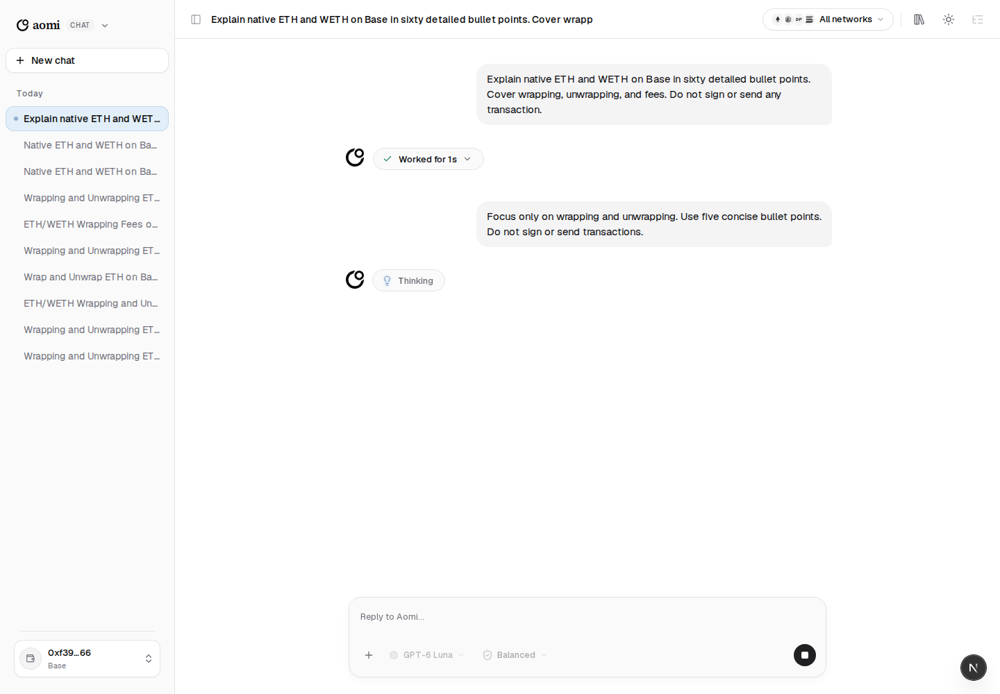
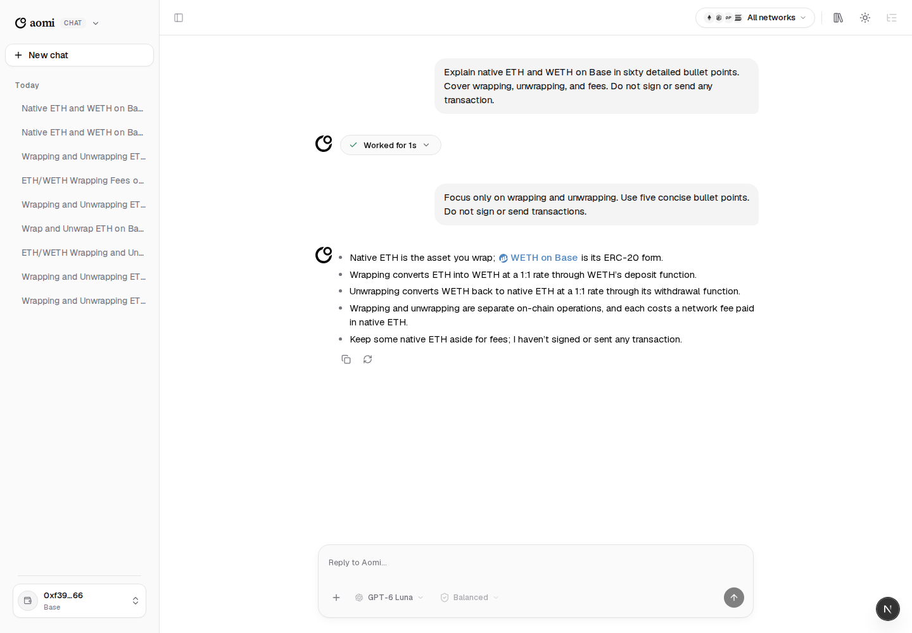

# Ordinary follow-ups during active work

These are actual local Portal screenshots using **GPT-6 Luna** and the local
Rust backend, not mockups. The existing composer and controls are retained.
There are no Queue/Update buttons or accepted/applied status messages.

The first Send was acknowledged with root
`turn_705dc8c520ac474496d58791804f8eb7`, revision 1. Ordinary Send during active
work admitted the follow-up on **that same root at revision 2**. One Start and
one Steer were observed; no separate request or queue entry was created.

The earlier working trace stays above the follow-up. The next working trace
starts below it:

The answer follows the revised five-bullet request. Reload retained both
assistant segments and sent no new mutations:

The run used the canonical fixture user in the isolated loopback worktree
database. Its local test credits were restored with an idempotent fixture grant
after an initial payment refusal. No transaction was signed or sent. The real
Vite guest embed also passed with Luna, ordinary Send, and the same root at
revision 2. CLI/SDK retain explicit Queue. Telegram/X continuation notices and
Telegram's Queue command are removed; adapter tests cover neutral delivery and
recovery. No additional Telegram messages were sent for this presentation pass.

Completion races retain the draft and require a deliberate new Send. A
follow-up sent before the first acknowledgement waits for that exact Start;
it cannot silently target newer work or rotate into a fresh guest conversation.
