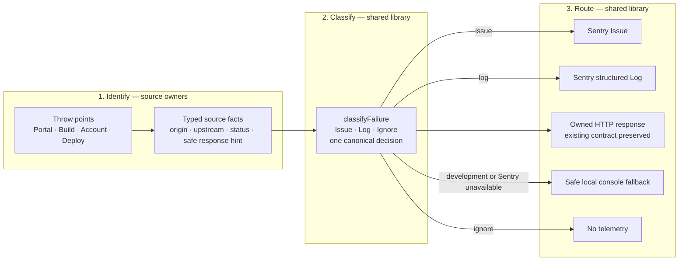

# BFF Sentry observability

Portal and Build report server failures through `@sentry/tanstackstart-react`,
configured in each app's `src/sentry.server.config.ts`. The Edge Worker uses
`@sentry/cloudflare`. The shared `@aomi-labs/observability` package builds on
`@sentry/node` and owns failure classification and privacy scrubbing.

## Error flow

Every handled or uncaught BFF failure follows exactly three layers. Portal
and Build do not own parallel classifiers or reporters; each app owns only a
service-bound pipeline instance whose error API is `handle(...)`.



Ownership is intentionally narrow:

| Layer    | Owner                                  | Responsibility                                                                                                                        |
| -------- | -------------------------------------- | ------------------------------------------------------------------------------------------------------------------------------------- |
| Identify | The package where the error originates | Preserve the original error and emit only bounded facts; deploy owns launch-domain identification and Account owns proxy observations |
| Classify | `@aomi-labs/observability`         | Make the single Issue/Log/Ignore decision and choose the safe public result                                                           |
| Route    | `@aomi-labs/observability`         | Deliver the decision to Sentry, the local console, the HTTP caller, or nowhere                                                        |

The only app-specific error objects are:

```ts
export const portalFailures = createFailurePipeline("portal");
export const buildFailures = createFailurePipeline("build");
```

A call point identifies its source and then receives the routed safe result:

```ts
return portalFailures.handle({
  source: "launch",
  error,
  context: { routeFamily, operation, method },
}).response;
```

The original design, its privacy and classification reasoning and the rollout
steps are in [the 2026-07-29 plan](../plans/2026-07-29-sentry-observability.md).
