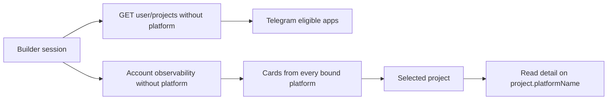

# Build Project Frontend Contract

The frontend has one persisted repository concept: `Project`. Repository
candidates exist only in the GitHub connection flow and never appear in the
Operate or bot-configuration data sets. Build has no Projects or Deployments
pages: its Packages and Agents pages read the builder's publisher through the
Build release routes (`docs/topics/bff/facts/endpoints.md`) and are read-only
for repo config.

```ts
type Project = {
  id: number;
  installationId: number;
  repositoryId: number;
  repositoryLink: string;
  platformId: number;
  ownerBuilderId: number;
  createdAt: number;
  updatedAt: number;
};

type UserProject = Project & {
  platformName: string | null;
  apps: PlatformApp[];
  latestDeployment: UserProjectLatestDeployment | null;
  sdkVersion: string | null;
  sdkVersions: string[];
};
```

There is no `AppSource`, `UserSource`, `app_source_id`, `/sources`, parsed
project configuration, or manifest-path selection adapter. The backend owns
`.aomi/config.json` parsing. The browser and CLI send `project_id`; preflight
may omit `source_ref`, receives the resolved immutable commit, and apply must
send that exact commit.

## Read scopes



Account-wide Operate and Telegram reads omit `platform`. This lets the
backend aggregate projects across different platforms. A single-project read
first proves account ownership, then uses that project's `platformName`; the
launch default must not override the binding.

## Page invariants

- Observability overview and detail share the same project identity. A card
  that links to detail cannot switch back to the default platform.
- App detail supports 1h, 24h, 7d and 30d activity windows, passed through the
  Edge to the manager and included in both caches. Activity uses 24 equal
  buckets across the selected window. Daily credits remain a separately
  labelled seven-day series; health cards retain their labelled health window.
  An older manager that ignores the selected window returns an explicit error
  instead of showing 24-hour counts under a seven-day label.
- Telegram configuration receives the same builder-wide projects collection,
  so every owned eligible application is selectable regardless of platform.
- Project creation persists only after the backend validates the repository's
  root `.aomi/config.json` at an immutable revision.

## Deletion boundary

Compatibility surfaces are deliberately removed instead of aliased. New code must not restore source-named routes, source identifiers, client
manifest parsing, GitHub candidate imports, or per-platform defaults on
account-wide reads.
